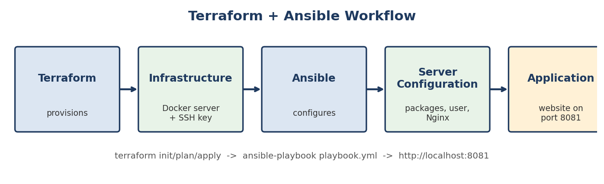

# Week 6: Infrastructure as Code & Configuration Management

**DevOps Internship | Davine Technologies | Release Date: 24 August 2026**

## Objective

Create and configure servers automatically instead of by hand. **Terraform** provisions infrastructure; **Ansible** configures it. Together they build repeatable DevOps environments.

## Topics Covered

- Infrastructure as Code (IaC)
- Terraform: providers, variables and outputs, state, modules
- `terraform init`, `plan`, `apply`, `destroy`
- Ansible: inventory, playbooks, modules
- Configuration management
- Terraform + Ansible workflow

---

## Weekly Task

| # | Exercise | Where |
|---|----------|-------|
| 1 | Install Terraform and Ansible | `Task/Task.txt` step 1 |
| 2 | Configure a provider | [`Task/terraform/main.tf`](Task/terraform/main.tf) |
| 3 | Basic configuration, variables and outputs | `main.tf`, `variables.tf`, `outputs.tf`, `terraform.tfvars` |
| 4 | Practice init, plan, apply, destroy | `Task/Task.txt` step 5 |
| 5 | Understand Terraform state | `terraform state list / show` |
| 6 | Module | [`modules/file_generator`](Task/terraform/modules/file_generator) |
| 7 | Ansible inventory | [`Task/ansible/inventory.ini`](Task/ansible/inventory.ini) |
| 8 | Playbook: install package, create user, start service | [`Task/ansible/playbook.yml`](Task/ansible/playbook.yml) |
| 9 | Terraform vs Ansible | table below, `Task/Report.pdf` |
| 10 | PDF report | [`Task/Report.pdf`](Task/Report.pdf) |

---

## Hands-on Activity: Application Server with Terraform + Ansible

**Scenario:** As a DevOps Engineer, prepare a new application server environment that is created consistently and configured automatically.

### Workflow



```
Terraform -> Infrastructure -> Ansible -> Server Configuration -> Application
```

### What Each Tool Does

| Step | Tool | Result |
|------|------|--------|
| Provision | Terraform | SSH key, server image and container (SSH 2222, HTTP 8081), generated `inventory.ini` |
| Configure | Ansible | Packages (nginx, curl, htop, vim), `appuser`/`appgroup`, website, Nginx config and service |
| Change | Ansible | Edit `welcome_message`, re-run: only the website changes |

### Run It

```bash
cd Activity/terraform
terraform init && terraform plan && terraform apply

cd ../ansible
ansible webservers -m ping
ansible-playbook playbook.yml
curl http://localhost:8081

# Make a change: edit group_vars/all.yml (welcome_message), then
ansible-playbook playbook.yml

# Clean up
cd ../terraform && terraform destroy
```

### Implementation Summary

Used Terraform to provision a Docker-based server with SSH access and generate the Ansible inventory. An Ansible playbook installed packages, created an application user, deployed a website and configured and started Nginx. Verified in the browser and with `curl`. Changed one variable, re-ran the playbook and confirmed the change applied automatically, and a second run made no changes (idempotent).

---

## Terraform vs Ansible

| | Terraform | Ansible |
|---|-----------|---------|
| Purpose | Provision infrastructure | Configure and manage servers |
| Approach | Declarative, tracks state | Procedural tasks, idempotent modules |
| Language | HCL (`.tf`) | YAML playbooks |
| State | `terraform.tfstate` | No state file |
| Connects via | Provider APIs (AWS, Docker, Azure) | SSH (agentless) |
| Typical use | Create VMs, networks, containers | Install packages, users, services, files |

## Key Commands

| Terraform | Ansible |
|-----------|---------|
| `terraform init` | `ansible all -m ping` |
| `terraform fmt` / `validate` | `ansible-playbook playbook.yml --syntax-check` |
| `terraform plan` | `ansible-playbook playbook.yml --check` |
| `terraform apply` | `ansible-playbook playbook.yml` |
| `terraform destroy` | `ansible-inventory --list` |

## Files in This Folder

| File | Description |
|------|-------------|
| [`Task/Report.pdf`](Task/Report.pdf) | Weekly task PDF report |
| [`Task/Task.txt`](Task/Task.txt) | Task steps and commands |
| [`Task/terraform/`](Task/terraform) | `.tf` files and a module |
| [`Task/ansible/`](Task/ansible) | Inventory, playbook, `ansible.cfg` |
| [`Activity/Activity.txt`](Activity/Activity.txt) | Activity steps and summary |
| [`Activity/workflow-diagram.png`](Activity/workflow-diagram.png) | Workflow diagram |
| [`Activity/terraform/`](Activity/terraform) | Provisions the Docker server |
| [`Activity/ansible/`](Activity/ansible) | Playbook, templates, variables |

## Safety Notes

- Never commit `terraform.tfstate`, `.terraform/` or `.ssh/` private keys (covered by the included `.gitignore` files).
- Always run `terraform plan` before `terraform apply` and read what will change.
- Test AI-generated IaC before using it.

## Key Learnings

- IaC makes environments repeatable and reviewable in Git.
- Terraform state links code to real resources and must be protected.
- Ansible is idempotent: a second run changes nothing if the server is already correct.
- Variables and modules keep configuration reusable.

---

**Previous:** [Week 5](../Week_5/README.md) | **Next:** [Week 7](../Week_7/README.md)