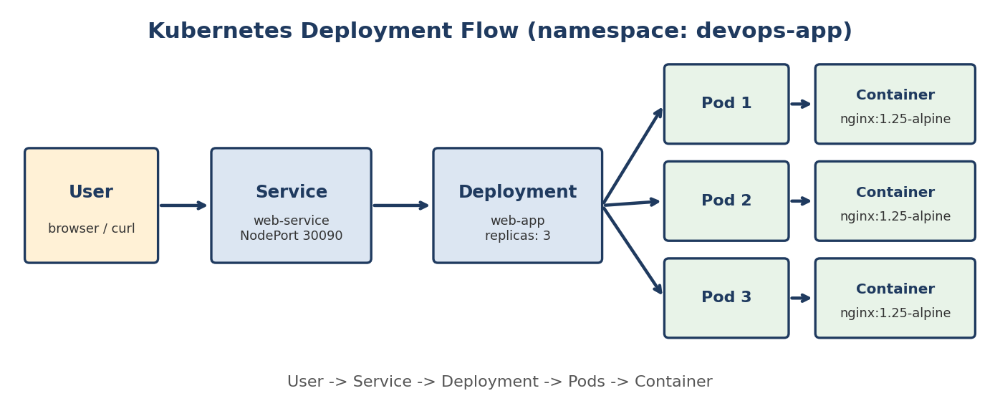

# Week 7: Kubernetes & Container Orchestration

**DevOps Internship | Davine Technologies | Release Date: 24 August 2026**

## Objective

Understand how Kubernetes runs, scales, updates and heals containerized applications: Pods, Deployments, Services, ConfigMaps, Secrets, Namespaces, `kubectl`, plus an introduction to Helm and Ingress.

## Topics Covered

- Kubernetes Fundamentals
- Pods, Deployments, Services
- ConfigMaps and Secrets
- Namespaces
- `kubectl`
- Helm: introduction
- Ingress: introduction

---

## Weekly Task

Manifests are in [`Task/`](Task). Apply order: namespace, configmap, secret, deployment, service.

| # | Exercise | File / Command |
|---|----------|----------------|
| 1 | Install Minikube or Kind, start a cluster | `minikube start --driver=docker` |
| 2 | Create a Namespace | [`namespace.yaml`](Task/namespace.yaml) |
| 3 | Create and manage Pods | [`pod.yaml`](Task/pod.yaml) |
| 4 | Create a Deployment | [`deployment.yaml`](Task/deployment.yaml) |
| 5 | Scale to multiple replicas | `kubectl scale deployment/web-app --replicas=4` |
| 6 | Create a Service | [`service.yaml`](Task/service.yaml) |
| 7 | Create a ConfigMap | [`configmap.yaml`](Task/configmap.yaml) |
| 8 | Create a Secret | [`secret.yaml`](Task/secret.yaml) |
| 9 | Practice kubectl commands | [`Task/Task.txt`](Task/Task.txt) |
| 10 | Explore Helm | [`helm-chart/`](Task/helm-chart) |
| 11 | Explore Ingress | [`ingress.yaml`](Task/ingress.yaml) |

---

## Hands-on Activity: Highly Available Web App

**Scenario:** As a DevOps Engineer, deploy a web application that stays available even when more replicas are required.

### Deployment Flow



```
User -> Service -> Deployment -> Pods -> Container
```

### Steps

| Step | Command |
|------|---------|
| Separate namespace | `kubectl apply -f k8s/namespace.yaml` |
| Deployment, 3 replicas | `kubectl apply -f k8s/deployment.yaml` |
| Expose with a Service | `kubectl apply -f k8s/service.yaml` |
| Scale up and down | `kubectl scale deployment/web-app --replicas=5` |
| Rolling update | `kubectl set image deployment/web-app web=nginx:1.27-alpine -n devops-app` |
| Check rollout | `kubectl rollout status deployment/web-app -n devops-app` |
| Roll back | `kubectl rollout undo deployment/web-app -n devops-app` |

`Activity/demo.sh` runs the whole sequence with pauses for screenshots.

### What Happened During Scaling and Rollback

- **Scaling:** the ReplicaSet created or removed pods until the count matched the desired replicas; the Service only routed to ready pods.
- **Rolling update:** with `maxSurge: 1` and `maxUnavailable: 0`, one new pod started and became ready before one old pod was removed, so there was no downtime.
- **Rollback:** `rollout undo` scaled the previous ReplicaSet back up and the new one down.

### Implementation Summary

Created the `devops-app` namespace and deployed a web application as a Deployment with 3 replicas, exposed through a NodePort Service. Scaled up to 5 and down to 2, then back to 3. Performed a rolling update from nginx 1.25-alpine to 1.27-alpine with zero downtime, checked the rollout, then rolled back with `kubectl rollout undo`.

---

## Pod vs Deployment vs Service

| Object | Role |
|--------|------|
| **Pod** | Smallest unit; one or more containers. Not recreated if it dies on its own |
| **Deployment** | Manages Pods through ReplicaSets: replicas, rolling updates, rollbacks, self-healing |
| **Service** | Stable IP/DNS name and load balancing across the Deployment's pods |
| **ConfigMap** | Non-sensitive configuration, separate from code |
| **Secret** | Sensitive values (base64-encoded, not encrypted by default) |
| **Namespace** | Logical isolation of resources |
| **Ingress** | HTTP routing by host/path into Services (needs an ingress controller) |

## Troubleshooting Order (DevOps Pro Tip)

```bash
kubectl get pods -n <ns>
kubectl describe pod <pod> -n <ns>     # events: ImagePullBackOff, Pending, probes
kubectl logs <pod> -n <ns>             # CrashLoopBackOff causes
kubectl get events -n <ns> --sort-by=.metadata.creationTimestamp
```

## Files in This Folder

| File | Description |
|------|-------------|
| [`Task/*.yaml`](Task) | namespace, pod, configmap, secret, deployment, service, ingress |
| [`Task/helm-chart/`](Task/helm-chart) | Minimal Helm chart |
| [`Task/Task.txt`](Task/Task.txt) | Task steps and kubectl commands |
| [`Activity/k8s/`](Activity/k8s) | Namespace, Deployment (3 replicas), Service |
| [`Activity/demo.sh`](Activity/demo.sh) | Scale, rolling update and rollback walkthrough |
| [`Activity/Activity.txt`](Activity/Activity.txt) | Activity steps, explanation and summary |
| [`Activity/deployment-flow-diagram.png`](Activity/deployment-flow-diagram.png) | Deployment flow diagram |

## Key Learnings

- Deployments keep the desired number of pods running and replace failed ones.
- Rolling updates with readiness probes update the app without downtime; `rollout undo` reverts quickly.
- Services give pods a stable address; selectors must match pod labels.
- ConfigMaps and Secrets keep configuration out of images. Secrets are only base64-encoded, so never commit real ones.
- Start troubleshooting with `get`, `describe` and `logs` instead of recreating everything.

---

**Previous:** [Week 6](../Week_6/README.md) | **Next:** [Week 8](../Week_8/README.md)